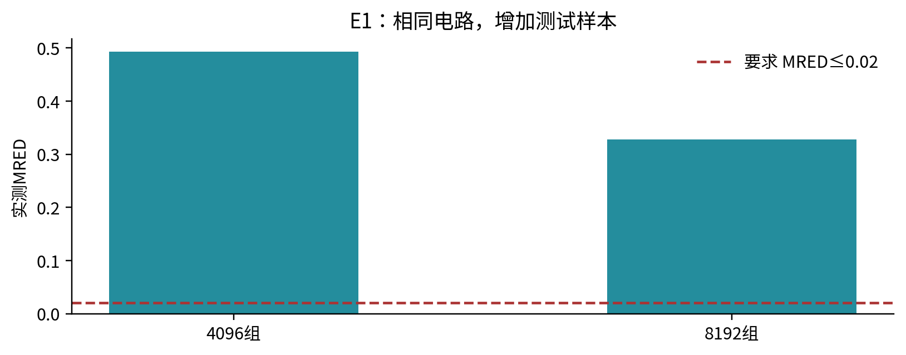
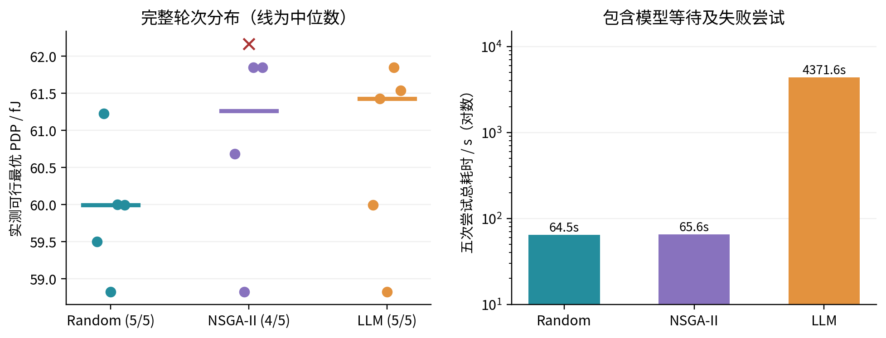
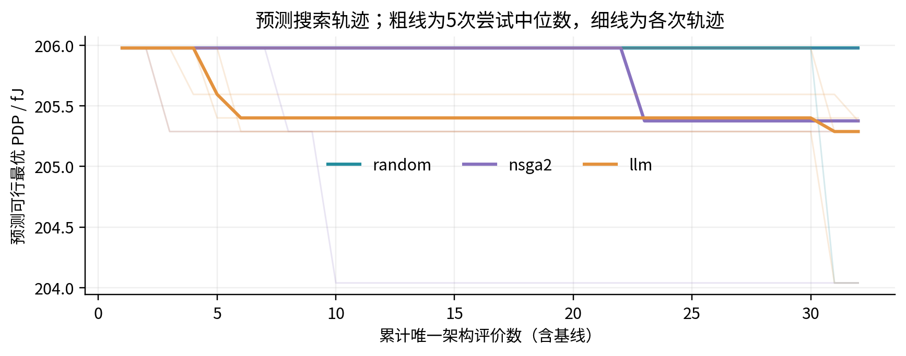
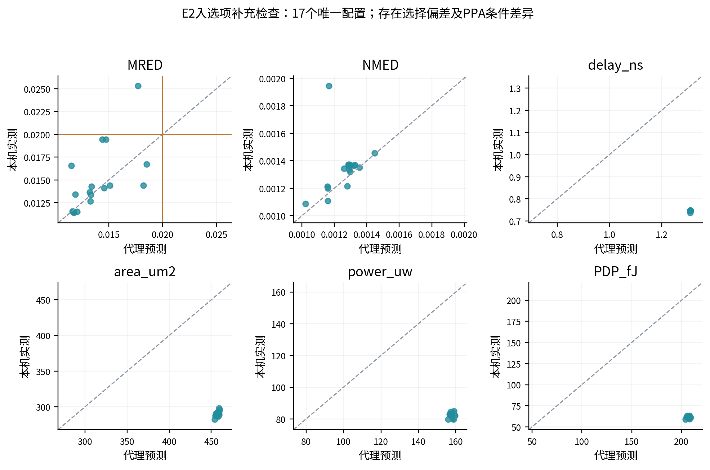
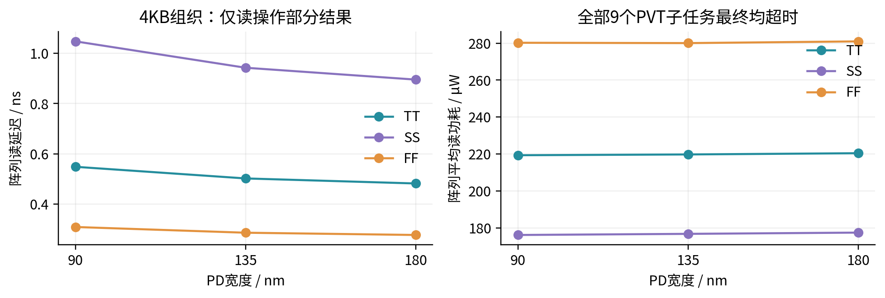
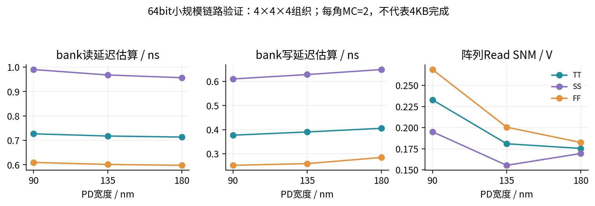
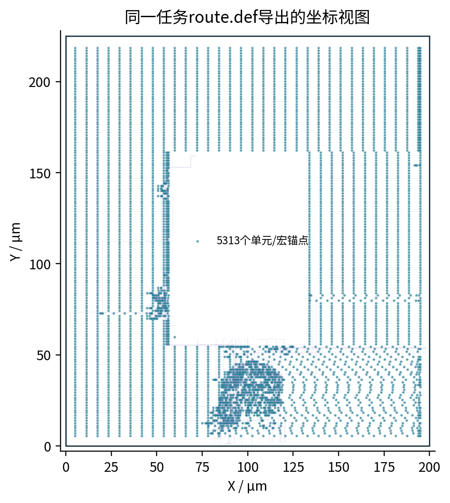

# E1—E6 问答与实验佐证报告

整理日期：2026-10-28。生成时间：2026-10-28T23:08:24.229358+08:00

## 实验结论与证据范围

本报告对应实验输入文档中的E1—E6，整合本轮通过命令行完成的真实问答，以及本机已保存的RTL、综合、STA、SPICE与物理后端结果。正文是基于证据的人工整理，附录保留助手最终回复原文；两者分别标注，避免把整理后的理想答案冒充模型输出。未重新运行历史长任务。

| 实验 | 本次证据 | 可支持的结论 |
| --- | --- | --- |
| E1 连续对话 | 12轮总问答中的E1链；新乘法器任务2个 | 参数解释、受控运行与继承的具体演示；不代表独立测试准确率 |
| E2 架构搜索 | 历史15轮尝试，14轮完整完成 | 已接通公平条件下三方法有限池比较；本组未显示LLM优势 |
| E3 经验消融 | 提交需求并记录回复 | 成对经验开关、快照排除及注入审计尚未形成正式实验 |
| E4 代理验证 | 补充分析17个唯一入选配置 | 仅选择后样本的跨条件一致性；独立20配置验证尚未完成 |
| E5 SRAM复验 | 4KB的9个子任务超时；64bit的9个完成 | 大组织保留部分读数据；小规模证明链路，不证明宏级良率 |
| E6 完整后端 | 本轮新任务 | 只按实际尺寸、周期及已完成阶段形成结论 |

关键发现：当前三方法对照中，随机、NSGA-II、LLM的完整且实测可行轮次PDP中位数分别为59.9959、61.2657、61.4295 fJ。LLM未呈现更低的中位PDP，且五次尝试累计耗时4371.554 s。失败记录必须保留，不能以“15/15有记录”写成“15/15完成”。

本轮16×8、10ns DCiM后端已实际执行：乘法输入65536组、错误0；setup/hold slack为4.64506/0.0331819ns，布线DRC为0。E1的sabetz复测均未满足MRED≤0.02；E3、独立E4及4KB完整复验仍未完成。

本轮最终回复共收集12条，其中model_used=true为12条。审计中的model_used只表示对话决策调用成功，结果文本还包含执行器依据实测数据渲染的内容。

### 本轮问答暴露的问题

| 位置 | 实际表现 | 对报告结论的影响 |
| --- | --- | --- |
| E1第4轮 | “重新验证”只生成8192组计划，没有自动启动 | 不能声称五轮链全部自动完成；另用官方run入口执行该计划补测 |
| E2/E5历史追问 | 明确任务ID仍返回“只有待运行计划” | 历史任务读取被当前草案遮挡；正文按真实result.json分析，原回复保留 |
| E4验证咨询 | 返回E2任务名，却混入E1乘法器MRED=0.492823 | 发生跨任务事实混用；该回复不作为实验数据或有效答案 |
| E1能力咨询 | 模型前言与事实模板存在重复 | 内容正确但冗长，后续应改善去重与表达 |

因此，本轮不能写成“E1—E6问答全部通过”。本报告交付的是实际执行和缺口审计，尚未修复以上对话代码。正文所有数值从指定任务的证据读取，不从上述错误回复摘取。

## 1　E1：连续交流、参数继承与真实结果

按“能力咨询→参数与MRED解释→4096组验证→只改8192组→结果追问”进行同一对话。电路为8位近似乘法器，9个可近似位置均用sabetz，测试种子42，约束MRED≤0.02。咨询轮次不应启动EDA；后续复测只修改样本数。

E1第3轮自动执行4096组；第4轮仅生成8192组计划。后者随后通过官方run入口执行原计划，作为一次显式补测，不冒充原对话已自动执行。

| 任务 | 采样 | 种子 | 压缩器ID | MRED | 任务状态 |
| --- | --- | --- | --- | --- | --- |
| 20261028_225710_multiplier_08fe9b | 4096 | 42 | 8 | 0.492823 | infeasible |
| 20261028_230235_multiplier_5cf3f6 | 8192 | 42 | 8 | 0.32794 | infeasible |

图1　相同sabetz电路两次抽样的实测MRED与0.02阈值。样本通过/失败结论仅适用于该测试集合。

两次完整参数的差异：{"compressor_ids": [null, [8, 8, 8, 8, 8, 8, 8, 8, 8]], "samples": [4096, 8192]}；约束数组保持一致。若第二次展开了9项均为8的compressor_ids，它与统一compressor_id=8等价，不是额外改变电路。

此处把“仿真正常完成”和“达到MRED阈值”分别判定。近似电路未达标也属于有效实验结果，不能提高阈值或删去失败值使演示通过。

两次RTL文件SHA256相同，且4096条逐输入对照记录与8192条中的前4096条完全相同。MRED随样本数变化来自测试集合组成变化，不能称电路被优化；两个集合都不满足0.02要求。

此前真实本地模型的开发回归记录为24/24轮通过（20261026_220158_example_acceptance_acc7b5），受影响搜索示例另有6/6记录；这些脚本禁止EDA并使用开发中反复修订的例子。它们仅是计划与回复回归，不作为留出集准确率或真实仿真成功率。

## 2　E2：随机、NSGA-II与LLM的架构搜索对照

沿用已完成尝试的历史任务 20261027_204422_search_comparison_d356cf。固定8位近似结构、AKbar2基线及器件尺寸；共同合法池256项（池种子1729），各方法使用搜索种子1—5，每轮32个唯一架构预算，含基线。每轮按相同规则最多复核3项；32次代理查询不等于32次EDA。目标是在实测MRED≤0.02的候选中最小化PDP。

测试输入种子42、4096组，综合库Nangate45 typical，输入活动周期5ns、输出负载10fF。PDP使用动态功耗×STA延迟，µW×ns数值单位为fJ；不能与总功耗PDP或后布局签核结果混写。

| 方法 | 完整/尝试 | 实测PDP中位数(fJ) | 样本标准差(fJ) | 总耗时(s) |
| --- | --- | --- | --- | --- |
| random | 5/5 | 59.9959 | 0.880109 | 64.539 |
| nsga2 | 4/5 | 61.2657 | 1.42718 | 65.554 |
| llm | 5/5 | 61.4295 | 1.2809 | 4371.55 |

| 方法 | GNN评价 | RTL启动 | STA/活动评价 | LLM选择调用 |
| --- | --- | --- | --- | --- |
| random | 160 | 15 | 15 | 0 |
| nsga2 | 160 | 15 | 14 | 0 |
| llm | 160 | 15 | 15 | 155 |

图2　各完整轮次的最终实测可行最优PDP与五次尝试总耗时。NSGA-II种子5有失败，不计入完整轮次中位数；红叉仅显示其部分测量值。

随机搜索的中位PDP比本组LLM低约2.33%，LLM累计耗时约为随机的67.7倍。此结果针对当前有限候选池和具体提案机制，不证明所有随机方法优于所有LLM或NSGA-II，也不以五次重复宣称统计显著性。两个方法都曾取得58.8247 fJ的相同候选，更应区分最小值与稳定性。

图3　GNN预测的可行最优PDP轨迹。它与图2的实测值量级不同，不能直接混成同一条“实测收敛曲线”。

| 搜索种子 | Random PDP | NSGA-II PDP | LLM PDP |
| --- | --- | --- | --- |
| 1 | 59.5051 | 60.6838 | 59.9959 |
| 2 | 61.2291 | 58.8247 | 61.4295 |
| 3 | 58.8247 | 61.8477 | 58.8247 |
| 4 | 60.0054 | 61.8477 | 61.8477 |
| 5 | 59.9959 | 62.1685（部分，失败） | 61.5395 |

NSGA-II种子5的第三项复核在RTL编译时失败：ha_6_0实例名重复，压缩器配置为[7,5,7,7,7,7,7,7,7]。另两项虽然有实测值，整轮仍属于失败，整组状态为incomplete。保留原始日志，不修改原始OpenACM生成器。后续若修复适配层并复跑，应建新任务及新版本对照，不能改写这份历史记录。

共同池、测试向量与综合库SHA256分别为：48493e6ef47f07c2eba3af2e50f7d684d11576f4ba4e5515c64e7d94ba8a2e03；5ad3ba175d9743f25d541bcde06213cdf778289d702a6b1f017ca7acf11a03b1；8d540a4d4cf6d09d27c87ad067857a9c0c2eeb023ab7a56e058cd3113db4e9b1。完整哈希和原始CSV随报告保存。

## 3　E3：持久经验的消融验证

已将文档中的经验消融需求作为真实问题提交。当前三方法compare不注入持久经验，不能将其中LLM组改称“有经验”。正式E3还缺少经验快照冻结、待测项排除、逐轮开关与注入证明、同搜索种子的配对调度。

本报告不填入经验带来的PDP提升或调用次数下降。可验证的系统能力是保存和检索观测，尚无证据说明权重已训练或经验已改善搜索。附录保留实际回复；正式图表须在上述配对实验完成后生成。

## 4　E4：预测—实测一致性补充分析

独立20配置的批量验收尚未接通。为让现有数据产生可核查图表，从E2的15轮复核中提取44次有完整指标的测量，包含MRED不满足的记录，按完整9位置配置去重得到17个唯一配置；重复测量按中位数汇总。执行失败项另存，不以0填补。

这些配置根据预测结果入选，具有选择偏差；训练/经验数据交叉情况尚未核验，训练标签的工艺、负载、活动条件也未完全对齐。因此下表是“入选样本跨条件一致性检查”，不称独立测试集泛化误差。

图4　入选唯一配置的预测与实测散点。虚线为数值相等，MRED橙线为0.02。PPA存在系统偏移，应先核对定义、工艺、负载和活动条件。

| 指标 | 样本数 | MAE | 平均绝对相对偏差(%) | Spearman ρ |
| --- | --- | --- | --- | --- |
| MRED | 17 | 0.00198477 | 11.2576 | 0.67402 |
| NMED | 17 | 9.41143e-05 | 6.11671 | 0.598039 |
| delay_ns | 17 | 0.5637 | 75.5565 | -0.102062 |
| area_um2 | 17 | 167.29 | 57.7206 | 0.5258 |
| power_uw | 17 | 75.5645 | 91.8488 | -0.00490196 |
| PDP_fJ | 17 | 145.381 | 236.808 | 0 |

| MRED≤0.02判定 | 实测可行 | 实测不满足 |
| --- | --- | --- |
| 预测可行 | 16 | 1 |
| 预测不满足 | 0 | 0 |

表中的“预测可行、实测不满足”是入选集合中危险的可行性误判数，不是全候选池假阳性率；缺少未入选样本不能推断全空间召回率。Spearman采用并列平均秩，常量列相关性留空；相对偏差对零分母单列，不能以任意小值替代。

正式E4应先冻结20个不按预测好坏挑选的合法配置，并核查训练/经验重叠，然后统一执行RTL、综合、STA和活动功耗。补充检查不能替代该实验，也不能靠简单比例缩放就宣称代理已重新校准。

## 5　E5：固定组织器件复验及运行瓶颈

4KB复验固定32768bit、输出8bit、32行×32列×32子阵列、列复用1。基线PU/PD/PG=90/90/135nm、L=50nm；只比较PD=90、135、180nm。三个PVT为TT/27℃/1V、SS/85℃/0.9V、FF/−40℃/1.1V；每角MC=2、种子42、相对标准差5%。

历史任务 20261026_144653_acco_sram_e635c9 已尝试全部9个尺寸/PVT组合，各子任务达到600s上限，总体failed。架构阶段只通过容量/接口检查；写操作和三种SNM未完整完成。原历史器件stage中的infeasible是状态归类错误，不能解释为电路不可行，原文件保持不动。

图5　4KB组织已保存的部分阵列读数据。不是整个bank的完整PVT通过结果，也没有写/SNM最优结论。

| PD(nm) | PVT | 阵列读延迟(ns) | 阵列读功耗(µW) | 完整案例 |
| --- | --- | --- | --- | --- |
| 90 | TT | 0.548693 | 219.359 | 失败/超时 |
| 90 | SS | 1.04732 | 176.191 | 失败/超时 |
| 90 | FF | 0.309395 | 280.234 | 失败/超时 |
| 135 | TT | 0.502481 | 219.782 | 失败/超时 |
| 135 | SS | 0.942516 | 176.8 | 失败/超时 |
| 135 | FF | 0.286687 | 280.053 | 失败/超时 |
| 180 | TT | 0.482475 | 220.447 | 失败/超时 |
| 180 | SS | 0.895377 | 177.474 | 失败/超时 |
| 180 | FF | 0.277706 | 280.983 | 失败/超时 |

在已有部分数据中，增大PD使读延迟减小，而读功耗略有变化；缺少写延迟与SNM不能据此推荐最终器件。后续应先对每个操作分配可观测预算并定位慢操作，再按同一大组织复验；不能静默缩小容量或减少MC来宣称4KB已通过。

### 5.1　64bit小规模验证：单独展示，不替代4KB

独立历史任务 20261026_144235_acco_sram_27ed9c 使用4×4×4=64bit组织、输出4bit，完成相同三PD×三PVT、每角MC=2的9个子任务。读/写/SNM来自阵列SPICE；bank延迟、功耗外围组合及面积为明确模型估算。

图6　64bit小规模PD/PVT取舍。最小样本数量用于链路检查，不能用于宏级良率或完整工艺签核。

| PD(nm) | 最坏读延迟估算(ns) | 最坏写延迟估算(ns) | 最小Read SNM(V) | bank面积估算(µm²) |
| --- | --- | --- | --- | --- |
| 90 | 0.990239 | 0.610865 | 0.195115 | 967.321 |
| 135 | 0.968039 | 0.629093 | 0.15548 | 979.766 |
| 180 | 0.956804 | 0.649909 | 0.169445 | 992.21 |

这个小规模样本中，增加PD没有同时改善读延迟、写延迟及Read SNM；默认鲁棒目标下基线仍是最佳已评价项。器件优化应展示取舍，不应预设尺寸越大整体越好。MC=2不形成概率置信区间或良率承诺。

## 6　E6：真实物理后端与证据链

本轮通过自然语言新建任务 20261028_230027_dcim_0026b3，实际规格为16行×8位、exact、backend=asic、时钟10.0ns、memory_impl=auto。任务状态为completed。

| 验收/测量项 | 结果 | 说明 |
| --- | --- | --- |
| 乘法器输入数 | 65536 | 是否穷举由计划exhaustive及位宽共同判断 |
| 乘法器错误数 | 0 | 不能替代完整PE控制状态穷举 |
| setup WNS (ns) | 4.64506 | ≥0才满足此项时序约束 |
| hold WNS (ns) | 0.0331819 | ≥0才满足此项时序约束 |
| 布线DRC数 | 0 | 工具报告；不是完整工艺DRC/LVS |
| 后端面积(µm²) | 7800 | 按后端报告定义，非bank公式估算 |
| 活动功耗(µW) | 251.24 | 给定VCD活动与库的模型结果，非芯片实测 |
| 门级/布线后/SDF对照数 | 306/306/306 | 按实际测试集合 |
| SDF timing checks / IOPATH | 294/1485 | 用于核查实际标注范围 |

| 后端阶段 | 状态 | 阶段耗时(s) |
| --- | --- | --- |
| synthesis | completed | 0.971 |
| post_synth_functional | completed | 0.281 |
| post_synth_sta_power | completed | 0.316 |
| floorplan_pdn | completed | 0.367 |
| placement | completed | 3.525 |
| cts | completed | 5.68 |
| routing | completed | 7.986 |
| rc_extraction | completed | 0.367 |
| post_route_functional | completed | 0.633 |
| post_route_before_sdf_sta_power | completed | 0.366 |
| post_route_sdf | completed | 49.554 |
| post_route_sta_power | completed | 0.417 |

图7　从同一任务真实route.def导出的单元锚点和布线坐标图，不是GDSII截图；不补画不存在的宏/导线。完整ODB/DEF/SPEF/SDF由原任务保存。

参考宏自动匹配相应尺寸，但并未根据E5的PD尺寸重新表征Liberty/LEF。此处证明参考PE后端能够执行，不用来证明E2/E5的优化已经传递到整PE收益。阶段完成、时序约束通过、功能覆盖和物理签核是不同结论。

## 7　可直接用于参赛文本的表述

系统以本地语言模型对接OpenACM，支持连续需求交流、结构化参数校验、隔离仿真与基于实际结果的中文反馈。已建立固定候选池和评价条件下的三方法架构搜索对照，并保留搜索决策、实测复核、失败日志及哈希证据。现阶段实验验证了自动化流程与可追溯性，尚未证明LLM搜索在当前任务中优于随机方法。SRAM器件阶段具备小规模多PVT/MC验证能力，4KB复验仍存在运行时间瓶颈。经验消融及独立代理泛化验证作为后续实验，不计入已完成成果。

## 8　证据索引与复现说明

| 证据 | 本地位置（相对于OpenACMAssistant） |
| --- | --- |
| 本轮原始问答 | docs/experiment-report/2026-10-27/evidence/live_chat_2026-10-28/dialogue.md |
| 报告数据快照 | docs/experiment-report/2026-10-27/evidence_snapshot.json |
| 统计CSV/独立图文件 | docs/experiment-report/2026-10-27/assets |
| E2 | runs/20261027_204422_search_comparison_d356cf |
| E5_4KB | runs/20261026_144653_acco_sram_e635c9 |
| E5_64bit | runs/20261026_144235_acco_sram_27ed9c |
| E6_history | runs/20261010_142841_dcim_4af72b |
| E6 | runs/20261028_230027_dcim_0026b3 |

证据快照复制了本报告引用的关键JSON和本轮最终问答；完整网表、波形、日志仍位于各runs任务。图表为这些文件的重新绘制，未训练任何新权重。重建命令：.venv/bin/python -B docs/experiment-report/2026-10-27/tools/build_report.py。报告生成器只读取本地证据，不启动模型或EDA。

所引用历史任务的源完整性记录：全部unchanged=true。这些是各任务当时的校验结果，不等同于对所有历史修改的全局证明；本轮新任务的校验保存在各自source_integrity.json。报告与附件全部存于助手专属目录，原始OpenACM程序及用户原Word文稿未改动。

## 附录A　本轮实际问答原文

以下是最终answer.md中的实际文本，未经改写。不收录模型内部思考。预览不等于已仿真，历史读取不等于本轮新执行；答非所问或状态误判也保留，以便继续修复。

### A.1　consult

用户：你能干什么？

助手原文：

我是一个OpenACM设计助手，可以回答关于OpenACM能力、参数和指标的问题，也可以把电路需求整理成配置，在独立副本中仿真、总结结果，并进行有预算的设计空间探索。

我可以回答OpenACM能力、参数和指标问题，也可以把电路需求整理成配置，在独立副本中仿真、总结结果，并进行有预算的设计空间探索。

支持五类工作流：SRAM与压缩器SPICE；整数乘法器RTL/综合；浮点乘法器RTL/综合；DCiM功能验证、综合和完整ASIC后端。

你可以先问参数，再说“做8位精确乘法器，穷举所有输入”；只看计划用“/plan 需求”，确定后说“开始运行”；结果出来后可问“是否达标”“为什么失败”“下一步怎么优化”。

原始OpenACM内置程序只读，调整在runs中的普通副本执行；任务保留配置、RTL/网表、日志、报告和源完整性校验。无需sudo。

审计：runs/20261028_225314_dialogue_5a628d；model_used=True，executed=False。

### A.2　consult

用户：8位乘法器有哪些参数？MRED是什么意思？

助手原文：

整数乘法器可以设置位宽、精确/近似/对数类型、统一或逐位置压缩器、原生或分块架构、采样数/穷举、测试种子，以及功能验证或综合流程。

MRED是输出相对于精确参考的平均相对误差；本助手排除精确参考为零的输入。MRED≤0.02是相对误差约束，不表示所有输出都正确。

审计：runs/20261028_225457_dialogue_55f4e1；model_used=True，executed=False。

### A.3　run

用户：做8位近似乘法器，所有近似位置用sabetz，固定种子采样4096组，要求MRED≤0.02。

助手原文：

8 位近似乘法器，固定种子采样验证：仿真完成，但要求未全部达标。

已验证 4,096 组输入，其中 4,059 组输出与精确参考乘积不一致。

错误率：99.0967 %。

平均相对误差 MRED：0.492823。

归一化平均误差 NMED：0.00340665。

最大绝对误差：568。

要求验收：
  • 平均相对误差 MRED ≤ 0.02：未达标（平均相对误差 MRED：0.492823）

误差以精确乘积为参考；MRED 排除参考乘积为零的输入。采样结果不代表完整穷举。

原始 OpenACM 完整性校验通过，文件未发生变化。

当前设计未满足全部要求；可以给出参数候选范围，比较其它设计。

详细报告：/data2/huangjj/OpenACMAssistant/runs/20261028_225710_multiplier_08fe9b/reports/report.md

审计：runs/20261028_225619_dialogue_3796ef；model_used=True，executed=True。

### A.4　plan

用户：其余不变，改为固定种子42采样8192组，并重新验证。

助手原文：

准备运行：8 位近似乘法器，固定种子采样验证。

验证输入：8192组采样，测试种子42。

评价流程：RTL功能验证。

压缩器：所有近似位置使用sabetz。

架构：按尺寸自动选择。

验收要求：平均相对误差 MRED：0.02及以下。

输入“开始运行”启动这项计划，也可以继续调整条件。

审计：runs/20261028_225722_dialogue_0c431c；model_used=True，executed=False。

### A.5　consult

用户：结果达标了吗？

助手原文：

当前只有待运行计划，还未进行该计划的仿真，不能判断是否达标；可以继续调整参数，或说“开始运行”。

审计：runs/20261028_225751_dialogue_3d5f28；model_used=True，executed=False。

### A.6　plan

用户：开展8位近似乘法器的架构搜索对照实验。以MRED≤0.02为硬约束，在可行候选中最小化PDP。预先固定相同的合法候选池和AKbar2初始配置，分别使用随机搜索、NSGA-II和LLM选择候选。算术测试固定为种子42、采样4096组；所有方法使用相同的综合库、5ns输入活动周期和10fF输出负载。将搜索随机种子与测试输入种子分开，每种方法重复5次，每次最多评价32个不同架构。本组固定器件尺寸，只比较架构选点。每次按相同规则选取最多3项进行RTL、综合和STA实测复核。分别记录预测可行与实测可行情况、最佳PDP、面积、候选数、EDA次数、LLM次数以及包含模型等待的总耗时。输出搜索曲线和重复实验结果分布，不预设LLM一定更优。

助手原文：

这次将比较随机搜索、NSGA-II、DeepSeek，每种方法运行5次。

每轮最多评价32个不同架构，包含同一个初始配置；从中选最多3个进行RTL、综合和STA复核。

测试输入固定为种子42、4096组采样；搜索种子为[1, 2, 3, 4, 5]。

各组使用同一候选池和Nangate45 typical库，输入活动周期5ns、输出负载10fF，器件尺寸固定。

验收要求：平均相对误差 MRED：0.02及以下。

输入“开始运行”启动这项计划，也可以继续调整条件。

审计：runs/20261028_225802_dialogue_dc619a；model_used=True，executed=False。

### A.7　consult

用户：任务20261027_204422_search_comparison_d356cf的结果如何？

助手原文：

当前只有待运行计划，还未进行该计划的仿真，不能判断是否达标；可以继续调整参数，或说“开始运行”。

审计：runs/20261028_225812_dialogue_c5172f；model_used=True，executed=False。

### A.8　clarify

用户：开展8位近似乘法器的经验消融实验，只比较LLM无经验与LLM有经验。两组均以MRED≤0.02为硬约束、以PDP最小为目标，固定相同合法候选池、AKbar2初始配置、器件尺寸、综合库、5ns输入活动周期和10fF输出负载。测试种子42、采样4096组；使用搜索种子1、2、3、4、5进行5组配对重复，每组最多评价32个不同架构，入选项使用相同规则实测复核。冻结并记录经验库快照和哈希，排除待测配置及本轮未来结果。保存逐轮模型请求、经验ID、经验是否实际注入、重复提案、失败、实测PDP和总耗时。若经验开关消融入口尚未接通，直接说明缺少什么并保留要求，不启动普通搜索替代，也不使用旧任务结果冒充本实验完成。

助手原文：

经验开关消融尚未接入，暂时不能直接运行这组实验；需要先支持冻结经验快照和逐轮注入审计。我会保留你给出的条件，不替换成普通搜索。

审计：runs/20261028_225835_dialogue_790487；model_used=True，executed=False。

### A.9　consult

用户：先不要运行仿真。请讨论8位近似乘法器PEA-GNN的独立验证要求：预先固定20个互不重复的合法配置，不按预测好坏挑选全部测试样本；记录它们与训练、经验检索数据的交叉情况，不能把来源不明的配置称为独立留出。每个配置保存完整压缩器分配、模型与缩放文件哈希、预测值和本机RTL、综合、STA及活动功耗结果。所有配置使用测试种子42、采样4096组、同一Nangate45 typical库、5ns输入活动周期和10fF输出负载，器件尺寸固定。分别评价MRED、NMED、延迟、面积、功耗和PDP的一致性，报告误差、排序和MRED≤0.02的可行性误判，保留全部失败与缺测。区分冷启动、加载后推理和完整EDA耗时。若没有独立配置批量验收入口，只说明需要补齐的功能，不生成普通探索任务替代；训练PPA条件无法对齐时，只能称跨条件一致性检查。

助手原文：

任务20261027_204422_search_comparison_d356cf：incomplete。

任务及证据目录：/data2/huangjj/OpenACMAssistant/runs/20261027_204422_search_comparison_d356cf

sample_count：4096。

error_count：4059。

错误率：99.0967 %。

平均绝对误差：221.518。

最大绝对误差：568。

平均相对误差 MRED：0.492823。

归一化平均误差 NMED：0.00340665。

验收mred le 0.02：不通过；实际值0.4928234136998939。

审计：runs/20261028_225846_dialogue_b8fb9a；model_used=True，executed=False。

### A.10　plan

用户：基于4KB任务20261025_143705_acco_sram_324799中的第13号架构，新建器件复验实验。固定总容量32768bit、输出字宽8bit，组织为32行×32列×32个子阵列，列复用比1。架构阶段只复核这一个组织，不重新搜索其他组织。基线保持PU=90nm、PD=90nm、PG=135nm、沟道长50nm。只比较PD=90、135、180nm三种尺寸，其余条件保持一致。分别评价TT/27℃/1V、SS/85℃/0.9V、FF/−40℃/1.1V三个代表性PVT组合。先采用每组合MC=2、种子42、相对标准差5%进行小批次验证。输出读写延迟、功耗、hold/read/write SNM、面积估算、每角原始样本、失败记录，以及相同条件下的基线对照。不擅自增加性能验收阈值，不用少量MC宣称宏级良率。为器件阶段预留运行时间；若预算耗尽，标记未完成，不能将未执行的候选判为不可行。

助手原文：

固定SRAM组织为32行×32列×32个子阵列，列复用比1。

架构阶段只做容量与接口校验，SPICE时间留给器件复验。

基线PU=90nm、PD=90nm、PG=135nm、沟道长50nm；只比较PD=90/135/180nm。

逐个评价这些PVT组合：TT/27℃/1V、SS/85℃/0.9V、FF/-40℃/1.1V。

每个组合MC=2，种子42，相对标准差5%；总时限7200秒。

保留读写、三种SNM、原始样本、失败记录和同条件基线比较；bank外围/面积为估算，小样本不代表良率。

总容量32768bit，输出字宽8bit。

尚未设置数值验收上限；如有精度要求，可以继续补充。

输入“开始运行”启动这项计划，也可以继续调整条件。

审计：runs/20261028_225915_dialogue_eb8fb4；model_used=True，executed=False。

### A.11　consult

用户：任务20261026_144653_acco_sram_e635c9为什么失败？

助手原文：

当前只有待运行计划，还未进行该计划的仿真，不能判断是否达标；可以继续调整参数，或说“开始运行”。

审计：runs/20261028_225924_dialogue_c7193e；model_used=True，executed=False。

### A.12　run

用户：做16×8精确DCiM全流程，穷举乘法输入，时钟周期10ns，要求setup slack不低于0ns、hold slack不低于0ns、布线DRC不超过0。

助手原文：

16×8 精确DCiM，完整后端：仿真完成。

已验证 65,536 组输入，其中 0 组输出与精确参考乘积不一致。

当前测试负载下的后端模型功耗：251.24 µW。

后端面积：7800 µm²。

有效输出检查：PE 常数输入 16 次；综合后 306 次；布线后功能 306 次；SDF 后仿真 306 次。

最差 setup slack：4.64506 ns。

最差 hold slack：0.0331819 ns。

详细布线 DRC 数量：0。

后端阶段：已完成 12/12 个已启动阶段。

要求验收：
  • 最差 setup slack ≥ 0ns：通过（最差 setup slack：4.64506 ns）
  • 最差 hold slack ≥ 0ns：通过（最差 hold slack：0.0331819 ns）
  • 详细布线 DRC 数量 ≤ 0：通过（详细布线 DRC 数量：0）

结论：在本次位宽的全部输入组合上，乘法器输出与精确乘积一致，穷举功能验证通过。

本次覆盖给定测试序列与参考宏库；功能/后端完成不代表覆盖所有输入流或流片签核。

原始 OpenACM 完整性校验通过，文件未发生变化。

可以继续提出参数修改，我会按同样流程重新验证。

详细报告：/data2/huangjj/OpenACMAssistant/runs/20261028_230027_dcim_0026b3/reports/report.md

审计：runs/20261028_225947_dialogue_c7d94c；model_used=True，executed=True。
