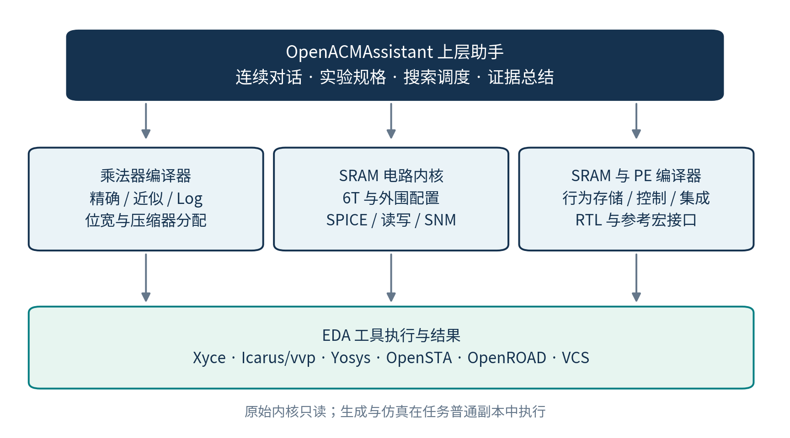
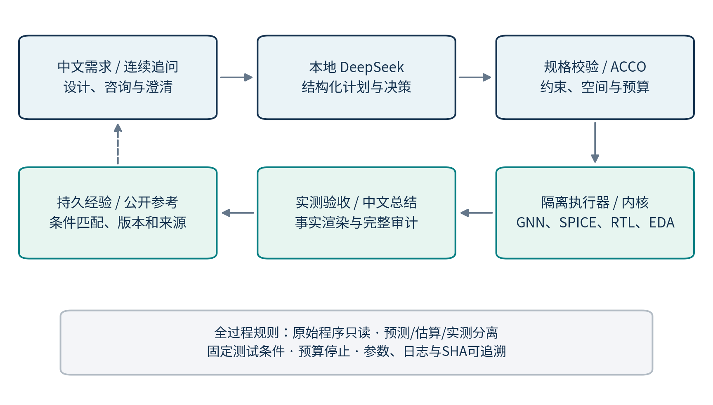
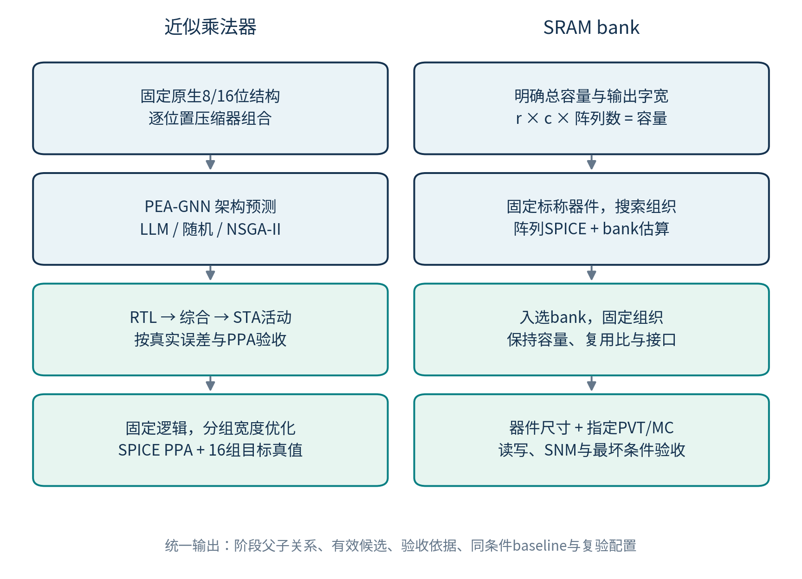
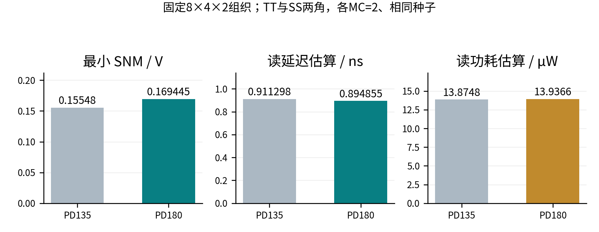

# OpenACMAssistant 技术报告

## 本地大模型驱动的近似存内计算电路设计与两级探索系统

参赛技术报告 · V1.0 · 2026年10月25日

代码基准：8566e1ac9eff28dc668404e10480ef2ac664a70b

## 摘要

近似数字存内计算将算术精度与电路硬件代价联系起来，其设计评估涉及压缩器组合、存储阵列组织、晶体管尺寸以及多种EDA工具。传统脚本流程要求使用者反复转换需求、修改配置、启动仿真并核对报告，容易发生测试条件遗漏、优化层级混杂和历史结果误用。针对这些问题，本作品在OpenACM电路生成与评价内核之上，构建本地DeepSeek驱动的交互式设计助手，将自然语言需求转化为受校验的实验规格，并在独立副本中执行设计、仿真、验收和结果整理。

系统以精度约束下的两级协同优化为研究主线：近似乘法器通过原生8/16位PEA-GNN及可选搜索策略筛选压缩器组合，再进行RTL、综合、STA活动功耗与单元器件真值复核；SRAM首先在固定容量和输出字宽下搜索bank组织，再固定入选组织开展尺寸及明确PVT/Monte Carlo评价。连续对话、证据驱动总结和模型无关的持久经验库贯穿上述过程。

现有小预算验证已覆盖SRAM两级流程、8/16位近似乘法器、真实DeepSeek架构选点及不达标负例。8位参考候选在4096组固定种子测试中MRED为0.013639，在指定5ns活动周期及10fF负载下，综合后STA动态功耗与延迟的乘积为63.1575fJ。相关任务均通过2631个原始OpenACM文件的完整性核验。现阶段成果证明工程流程能够执行与追溯；不据此宣称LLM优于其他优化器、完成论文全部实验或达到工艺签核。

**关键词：** 本地大语言模型；近似存内计算；OpenACM；设计空间探索；PEA-GNN；两级优化；证据追溯

## 阅读导航

1. 研究背景与作品定位
2. OpenACM内核与本作品的关系
3. 总体架构与连续交互
4. 两级设计空间探索方法
5. 可靠执行与证据管理
6. 持久经验与公开数据
7. 实验设置与验证结果
8. 核心亮点与应用价值
9. 部署、演示与复验
10. 当前边界与后续研究
11. 总结
12. 参考资料与证据索引

## 1 研究背景与作品定位

### 1.1 研究对象

数字存内计算（Digital Compute-in-Memory，DCiM）通过将存储与计算靠近，减少数据搬移。近似计算进一步允许在明确的应用误差预算下，使用较低硬件代价的算术电路。一个候选设计是否值得采用，取决于其计算误差、功耗、性能、面积以及工作条件，不能仅由某一项指标或生成成功与否决定。

本报告以用户提供的DATE.pdf和DAC.pdf为研究依据。前者介绍OpenACM的SRAM近似DCiM编译和评价基础；后者提出OpenACMv2中的精度约束协同优化（ACCO），强调架构搜索与晶体管尺寸优化的层级关系。[1][2] 本作品在此基础上增加本地语言交互、可信执行、搜索调度和经验复用能力。论文中的性能提升数字不作为本作品的本机实测结果。

### 1.2 面临的工程问题

| 问题 | 具体表现 | 本作品的处理方式 |
|---|---|---|
| 需求与脚本之间存在转换成本 | 位宽、压缩器、容量、PVT和误差阈值分散在不同文件 | 将需求整理成结构化实验规格，进行类型、单位、范围和组合校验 |
| 多工具流程难以连续操作 | 生成、SPICE、RTL、综合与时序分析各有入口 | 由外部执行器编排，按任务保存输入、工作副本、日志和报告 |
| 搜索变量与评价层级混杂 | 在固定小阵列上混合调整供电、尺寸和外围，却解释为bank优化 | 区分架构级与器件级，显式固定容量、入选结构和评价条件 |
| 模型回答缺少验收依据 | 将预测值、旧结果或模型的“已达标”文字当作测量 | 用真实工具结果判断约束，预测、估算与实测分别标记 |
| 历史经验难以复用 | 数值保留在零散报告中，条件与版本容易丢失 | 建立带来源、环境和修订的本地经验库，并提供JSONL交换接口 |

### 1.3 作品范围与贡献归属

本作品定位为“面向近似DCiM研究的本地智能设计与探索助手”。其主要贡献是把既有电路生成、评价及优化能力组织成连续、可校验、可追溯的实验流程。OpenACM/OpenYield中的编译器、网表、模型、PEA-GNN权重及原NSGA-II算法来自原工程；本作品不将这些基础能力列为自行提出的新算法。

本作品新增的实现包括统一设计对话、规格约束与预算管理、两级流程隔离适配、候选和父子关系记录、实测验收与中文总结、持久经验及公开数据参考接入。当前LLM从受校验的有限候选中选择实验，不直接生成并执行任意程序，也不修改OpenACM内置代码。

## 2 OpenACM内核与本作品的关系

### 2.1 内核承担的基础能力

本报告中的“内核”指OpenACM电路编译与评价核心，不指操作系统内核。OpenACM将乘法逻辑、存储模块及PE集成到一套可配置流程中，为上层助手提供真实的电路和工具调用对象。

| 内核模块 | 主要作用 | 与助手的衔接 |
|---|---|---|
| 乘法器编译器 | 生成精确、可配置近似和对数乘法RTL；近似类型由各压缩位置的选择控制 | 助手设置位宽、类型、位置分配和输入测试，再调用原生成器 |
| SRAM电路编译与测试平台 | 根据阵列、6T器件和外围配置生成SPICE，评价读写与SNM | 助手生成任务内配置，调用Xyce，提取有效样本和保守统计 |
| SRAM行为级与PE编译器 | 生成存储行为、控制及乘法器集成RTL | 助手选择PE尺寸、存储实现和验证流程，检查实际接口行为 |
| 数字物理流程 | 使用标准单元、参考宏及工具脚本完成综合与后端评价 | 助手适配并校验阶段结果，保存时序、DRC、面积与活动功耗证据 |
| 研究优化资产 | 原生8/16位GNN、压缩器尺寸模板及多种优化研究实现 | 当前助手隔离接入PEA-GNN、逐组宽度接口和原NSGA-II；其他算法不自动视为可用 |

需要区分两条SRAM路径：行为级SRAM RTL用于功能及PE集成；晶体管级SRAM SPICE用于电路评价。行为级仿真通过不能证明6T单元电路达标，SPICE中的尺寸变化也不会自动更新PE后端使用的参考宏Liberty/LEF。

### 2.2 上层助手与内核的接口边界

OpenACM原目录保持只读。助手按任务复制普通文件、生成独立参数配置，并调用原工程能力。执行产生的RTL、SPICE、模型副本、波形和报告均进入任务目录；不在原目录启动生成器，不使用可写硬链接来共享原文件。

OpenYield提供SRAM组织构造和面积模型。本作品复用其实际源代码副本，同时通过显式容量配置避免沿用旧实验脚本中的硬编码容量。原工程存在某项脚本，不等于其已成为本作品的可用入口；当前实际支持范围由校验器、适配器和验证证据共同确定。[3][4]



## 3 总体架构与连续交互

### 3.1 分层架构

系统包含交互与模型层、规格与调度层、隔离执行层及证据与经验层。模型理解用户问题并组织决策，校验器决定配置是否可执行，EDA提供电路结果，证据层负责验收与追溯。



| 层次 | 关键实现 | 职责 |
|---|---|---|
| 交互与模型 | assistant.py、conversation.py、领域skill | 连续理解能力咨询、规格补充、解释、执行和结果追问 |
| 规格与调度 | spec.py、bindings.py、acco_spec.py、acco.py | 显式字段绑定、两级实验契约、预算、候选选择、阶段父子关系 |
| 隔离与工具 | guard.py、worker.py、acco_models.py、acco_physics.py | 写隔离、原工程适配、SPICE、RTL、综合、STA与器件功能检查 |
| 证据与经验 | result_summary.py、experience.py、public_dataset.py | 结果验收、事实驱动摘要、观测修订、条件匹配和外部参考 |

### 3.2 统一连续对话

系统维护聊天上下文、当前设计、待澄清需求、尚未执行的草案及最近真实任务。解释性问题与设计需求共享上下文，不要求用户切换到独立的“咨询模式”或“执行模式”。例如，“已有探索结果能做什么”可衔接配置比较、Pareto分析与复测；“解释最佳配置，然后复测”可在一轮中先说明已有事实，再启动明确的验证。

缺少规格时，系统保留原始需求，并把下一轮补充并入同一实验。对SRAM两级探索，必须明确总容量和输出字宽，不能用默认16×8阵列替代容量。通过/plan得到的草案不算实测结果；用户要求开始运行后，执行器使用保存的完整实验配置。

### 3.3 从自然语言到可执行规格

规划接口使用受约束JSON，顶层包含电路类型、参数、验收约束和可选目标。两级入口进一步记录架构域、器件域、分阶段预算及物理条件。明确参数由规则与Schema共同固定，防止模型把“全sabetz”换成其他压缩器，或将阈值只写入解释文字。

输入参数、硬约束与排序目标分别表达。例如，“8位”是结构输入，“MRED≤0.02”是验收条件，“PDP最小”是排序目标，“预算64个候选”是资源限制。未给出性能阈值时，模型不得自行添加。模型输出截断或未通过校验时只恢复一次；持续无效则停止，保留诊断而不启动仿真。

## 4 两级设计空间探索方法

### 4.1 实验契约与预算

将一项两级实验表示为：电路基线、架构搜索域、器件搜索域、硬约束、分阶段目标、PVT/测试条件和预算。架构变量描述结构；器件变量描述入选结构中的尺寸；二者在不同阶段求解。

| 配置字段 | 含义 | 关键约束 |
|---|---|---|
| plan | 同一电路的普通单点基线 | 不含独立sweep，电路类型需一致 |
| architecture_space | bank组织或逐位置压缩器类型 | 不混入器件尺寸，满足容量或拓扑要求 |
| device_space | SRAM宽度/外围倍率，或压缩器分组宽度倍率 | 固定入选架构和逻辑功能；不自动改变沟道长 |
| architecture / validation | 架构评价与乘法器复核上限 | 代理评价与真实复核分别计数 |
| shortlist / device_per_parent | 入选父项数及各父项或单元的器件预算 | 包括同条件baseline；不能等同底层SPICE调用总数 |
| max_seconds | 整管线墙钟预算 | 超时保留已执行阶段，标记incomplete |



### 4.2 近似乘法器架构级

在固定原生压缩树中，以配置向量x=(c1,…,ck)描述每个可近似位置的类型。当前8位有9个位置、16位有49个位置，每个位置可选8种已有类型。仅8位的完整组合数即为8^9=134,217,728，穷举所有架构通常不合适。系统保留位置顺序，并通过16组压缩器真值核对助手编号与GNN特征编号。

PEA-GNN输出MRED、NMED、延迟、面积和功耗预测。系统核对标签反归一化文件和单位，记录权重与图辅助代码SHA256；原功耗尺度由W换算为µW。架构阶段默认以预测PDP和MRED形成目标，明确的误差约束参与筛选。预测字段统一使用predicted_前缀，不能进入实测验收。

压缩器编号或图结构与模型训练范围不一致，会导致预测失去意义。因此已有GNN只用于原生8/16位近似结构；其他尺寸可使用已有单点或局部验证适配器，不能直接外推该权重。

### 4.3 入选项的真实复核

入选配置重新生成RTL，并使用独立无符号精确乘法参考计算误差。当前MRED排除精确参考为0的项，NMED按最大无符号乘积归一化：

```text
MRED = mean(|y_hat - y| / y), 仅统计 y ≠ 0 的测试项
NMED = mean(|y_hat - y|) / (2^n - 1)^2
PDP[fJ] = P_dynamic[µW] × D_STA[ns]
```

随后使用Nangate45 typical库完成综合，逐向量进行门级与RTL对照，再运行OpenSTA延迟和VCD活动功耗分析。输入活动周期与配置时钟保持一致，明确输出负载，并要求存在有效活动标注。这里的“实测”指实际运行仿真与EDA工具得到的模型结果，不是流片后的硅片测量。

误差、PDP及其他已支持约束在复核后统一判断。即使预测可行，或算术误差通过，只要实际PDP越界，就不能进入可推荐集合。预测与实测差异独立保存；条件未完全对齐时，不将该差值直接称为GNN同分布测试误差。

### 4.4 乘法器器件级

对已通过架构实测约束的候选，使用原压缩器模板的共享晶体管分组，分别调整各组宽度。当前尺度域允许原宽度的0.5–2倍，并继续检查模板的绝对宽度范围；保持逻辑结构及沟道长。

每个尺寸候选都运行SPICE PPA评价，并用16组输入检查电压输出是否符合该近似压缩器本身的目标真值。近似逻辑的功能保持约束，不是强制它变成精确压缩器。当前模板使用简化LEVEL_1模型，逻辑电平核验采用VOL≤0.24V、VOH≥0.96V及1.2V供电。失败或电平不合法的候选不参与推荐。

该阶段保存分组宽度、单元PDP和面积估算。定制单元尚未重新表征为Liberty并回灌完整乘法器或PE，因此器件阶段收益只在该单元模型范围内成立，不能与综合后架构PPA混为同一条优化曲线。

### 4.5 SRAM架构级：固定容量的bank组织

SRAM架构表示为(r,c,µ,N)，分别为行数、列数、列复用比和阵列数量，并满足：

```text
r × c × N = C_total_bits
N 必须为整数；当前实际电路支持 µ ∈ {1, 2}
```

总容量和输出字宽是独立规格。若单阵列输出不足一字，系统记录序列化周期，并在模型中计入延迟；不把不同吞吐条件视为相同接口性能。架构阶段固定标称器件及PVT，评价不同组织。

bank评价采用明确的混合模型：单阵列功耗与延迟来自SPICE，面积复用OpenYield模型，片选与bank复用代价采用解析估算。未激活阵列主要按漏电计入，不能将整个动态功耗简单乘阵列数；已经在阵列SPICE内的2路列MUX也不重复增加。bank相关数值保留_estimate后缀。

定义Pmax=max(Pread,Pwrite)，Dmax=max(Dread,Dwrite)。架构FOM采用论文对应形式，并固定W、m²、s单位：

```text
FOM_arch = -log10(Pmax × sqrt(A_bank) × Dmax)
```

FOM越大越好。单位约定改变会影响对数值，因此跨实验比较前必须统一单位、接口、容量及外围模型。

### 4.6 SRAM器件级与鲁棒性

对入选组织固定r、c、µ和N，调整PU、PD、PG或已开放的外围宽度倍率。每个候选按相同的明确PVT案例、随机种子和MC预算运行读写及hold/read/write SNM。

实现使用原器件模型参数vth0、u0和voff的均值，按绝对均值乘相对标准差生成高斯样本。vth_std=0.05表示相对5%，不是“0.05V阈值电压标准差”。读写测试为阵列内6T单元构造参数样本；SNM针对目标bitcell。这是当前实现的统计假设，不能据少量样本推断整宏良率。[4]

跨角评价对功耗、延迟取最坏值，对SNM取最小值，再重新计算FOM。当前默认工程鲁棒FOM为：

```text
FOM_robust = log10(SNM_min / (Pmax × sqrt(A_bank) × Dmax))
```

该式是本助手采用的工程定义；DAC提供了鲁棒性优化思路，未给出此唯一显式公式，不能将其归为论文原式。SPICE失败、无效测量或非正SNM均不能作为达标点。

### 4.7 搜索策略、排名与停止规则

当前可选策略为LLM、固定种子随机和隔离副本中的原NSGA-II。LLM从程序生成的合法候选菜单选择，决策请求、回复和选择均留档；服务不可用时回退为随机并明确标记random_fallback。用户可为架构与器件分别选择求解器。

搜索缓存重复配置，按唯一候选控制评价预算。原NSGA-II小种群可能出现重复初始点，适配层对初始种群去重，并增加提案数和外层时间限制，避免无效循环；原算法文件保持不变。

有效候选先通过硬约束，再计算Pareto非支配集合。列表中的“最佳”按配置目标顺序进行字典序排序，不能解释为唯一的多目标最优解；Pareto集合保留其他权衡。所有最优结论只针对本次实际评价过的候选。策略优劣仍需同空间、同条件、同预算和多种子实验验证。

## 5 可靠执行与证据管理

### 5.1 无sudo隔离执行

系统运行于普通用户权限下的Linux x86_64环境，采用Landlock ABI≥3限制仿真子进程的文件写入。任务副本、缓存、临时目录和工具产物集中到当前run；仅保留/dev/null、/dev/tty等必要设备写入例外。读和执行能力仍用于访问已安装工具。该机制是文件写隔离，不等同完整网络隔离或容器化部署。

父子进程继承写限制；隔离能力不可用时拒绝无保护执行。运行前后对OpenACM原始非Git文件进行清单与SHA核对。复用的OpenYield文件另以reference_manifest记录哈希；此处不将部分复用文件核验夸大为整个OpenYield目录核验。

### 5.2 状态与验收分离

| 状态或证据 | 含义 | 不应推导出的结论 |
|---|---|---|
| prediction | 已运行代理推理 | 用户指标已实测达标 |
| completed | 所记录流程完成，具体约束需结合任务结果 | 全局最优、全输入正确、IEEE合规或工艺签核 |
| infeasible | 已有评价显示约束未全部满足 | 整个设计空间都不存在可行解 |
| unverified_constraints | 缺少对应指标的有效测量 | 可忽略该约束继续宣布达标 |
| incomplete / failed | 预算中断或执行异常 | 已完成全部阶段或可用预测补齐缺失结果 |

每个数值同时关联配置、测试分布、库、时钟/活动、PVT及证据种类。数组SPICE、bank估算、综合后STA和单元SPICE分别保存，禁止跨层级填充指标。

### 5.3 证据驱动的中文总结

仿真结束后，执行器从结果文件构造可信事实和必须呈现的结论。DeepSeek可选择事实重点与顺序，数值仍由执行器渲染；未知事实ID和虚构建议被拒绝，模型整理失败时回退为实际数据摘要。

摘要直接展示完成状态、最佳已评价项、关键指标、约束是否通过、器件尺寸和使用范围，不要求用户手动查找报告。详细报告、模型整理请求与回复继续保留，便于核对原始证据。

### 5.4 专属目录与版本追溯

```text
OpenACMAssistant/
  app/                 交互、校验、调度、隔离与工具适配
  skills/              电路领域能力、规则及接口参考
  examples/            可审阅、可复验的实验规格
  runs/<任务>/         工作副本、阶段、波形、日志、报告与完整性
  experience/          SQLite经验索引及JSONL交换文件
  datasets/            带版本和来源的公开参考
  docs/technical-report/  技术报告及图表
```

每次新实验创建新目录，不覆盖历史任务。best_experiment.json保存SRAM最佳完整容量/PVT配置或乘法器锁定位置分配，best_device_designs及widths.json另存单元尺寸；observations.jsonl导出阶段观测。完整运行、模型权重、经验和本机配置不进入助手代码仓库。

## 6 持久经验与公开数据

### 6.1 本地经验的记录与检索

本地SQLite记录完整参数、约束、状态、实际指标、失败原因、源码与执行器指纹、工具环境、数据质量和证据路径。同任务重复导入保持幂等；结果修订保留历史版本；检索优先使用最新可信观测。

经验按电路、尺寸、输入测试、PVT、负载、后端与环境匹配。同范围记录可以作为待复验候选；不同条件、旧数据或外部导入降为参考。历史成功不意味着新任务无须运行，历史失败也不意味着整个类型不可行。

存储和检索接口不依赖DeepSeek品牌。标准JSON/JSONL可由其他模型的适配器读取，Ollama兼容模型也可切换后共用经验。这里的“持续学习”是持续积累观测并检索使用，不是自动梯度训练或在线更新权重。

### 6.2 公开数据的接入与条件核对

项目已归档公开8位乘法器数据的固定快照，包含50,000个唯一配置、九位置选择和五类标签，并建立来源与本地映射核验。[5] 参考检索只使用本地明确划分的训练部分，验证/测试部分不进入决策上下文；真正重新训练代理模型时，缩放参数应仅由训练集拟合。

公开数据与本地生成及测量条件并未完全一致。已核验的公开样本40499，其发布MRED为0.01927266，而本地4096组、种子42的RTL复测为0.0216472906；按0.02阈值，前者看似通过，后者不通过。因此公开标签不能替代本地验收，也不能直接并入同条件训练集。

当前接入用于检索参考和候选引入，没有执行GNN/LLM权重训练。数据附件保留原许可证声明，不将第三方数据改标为助手代码许可；公开数据条件、单位和来源版本仍需逐项审查。

## 7 实验设置与验证结果

### 7.1 验证目的与环境

本报告使用2026年10月8日至25日已保存的本机证据，报告生成时重新读取结果与完整性文件，不重新执行大规模搜索。本轮核心两级证据为2026年10月25日的小预算实验；历史DCiM后端记录用于说明基础工具链覆盖，不作为器件优化已回灌PE的证明。

| 项目 | 本报告采用的范围 |
|---|---|
| 模型交互 | 本机Ollama中的deepseek-script；部署说明基于DeepSeek-Coder-V2 Lite量化模型，端点与模型名可配置 |
| 代理运行 | 原8/16位PEA-GNN；CPU推理；Torch 2.6.0 CPU与PyTorch Geometric 2.6.1依赖 |
| 数字实测 | Icarus/vvp、Yosys、Nangate45 typical及OpenSTA；PDP使用动态功耗 |
| 乘法器活动条件 | 5ns输入活动周期、10fF输出负载；种子42；样本数按各项列出 |
| SRAM鲁棒性冒烟 | 64bit容量、4bit输出；TT/27℃/1V及SS/85℃/0.9V；每角MC=2，相对标准差5% |
| 代码和来源 | 助手提交8566e1a；原工程具体输入以各任务清单及SHA为准 |

样本数与预算均较小，适用于工程流程验证。尚不具备宣称搜索效率提升百分比、LLM最优性或统计良率的依据。

### 7.2 SRAM固定容量的两级验证

E01设置2个架构评价、1个入选组织和2个器件候选。架构阶段在相同标称条件下比较4×4×4与8×4×2，两者容量均为64bit，输出字宽均为4bit。入选8×4×2后，仅调整PD宽度，其他基线尺寸保持PU=90nm、PG=135nm、L=50nm。[E01]

| 阶段及候选 | 读功耗估算/µW | 读延迟估算/ns | SNM最小值/V | 本阶段FOM |
|---|---:|---:|---:|---:|
| 架构：4×4×4，标称PD135nm | 12.293779 | 0.719823 | — | 18.557527 |
| 架构：8×4×2，标称PD135nm | 13.847376 | 0.577805 | — | 18.693364 |
| 器件：固定8×4×2，PD135nm，PVT/MC | 13.874822 | 0.911298 | 0.155480 | 17.686300 |
| 器件：固定8×4×2，PD180nm，PVT/MC | 13.936617 | 0.894855 | 0.169445 | 17.727078 |

表中前两行采用FOM_arch，后两行采用FOM_robust，不跨阶段比较其数值大小。架构选择没有只按读功耗最小值判断；FOM同时考虑读写功率、延迟与面积。器件阶段相同PVT/MC条件下，PD180nm相对PD135nm的最小SNM提高约8.98%，读延迟降低约1.80%，读功耗增加约0.45%，体现了真实取舍。该结论仅对应本次两点及模型条件，不是普遍最优尺寸。



本项共执行6个阵列任务：2次标称架构评价，加上2个器件候选各2个PVT案例。最佳项bank面积估算为648.757583µm²，hold/read/write SNM分别为0.3303099V、0.1694452V和0.6825216V。该实验未要求SNM≥0.2V，不能声称已达到此阈值。4KB示例已提供配置与真实模型计划预览，本报告不将64bit冒烟当作4KB大规模优化结果。

### 7.3 8/16位乘法器两级验证

E02的8位架构阶段实际执行4次GNN评价，选择1项进行RTL/综合/STA复核，并执行2个单元器件候选；E03的16位流程用于验证另一原生模型及49位置结构的接通，架构、入选和器件预算均为1。[E02][E03]

| 指标 | 8位参考候选，4096组 | 16位参考候选，256组 |
|---|---:|---:|
| MRED | 0.0136390362 | 0.0005626603 |
| NMED | 0.0013711373 | 0.0000191671 |
| 与精确结果不同的输入数 | 2674 | 224 |
| Nangate45综合面积/µm² | 291.802 | 1215.354 |
| STA延迟/ns | 0.74663091 | 1.36742842 |
| 指定活动下动态功耗/µW | 84.5899522 | 313.9475160 |
| PDP/fJ | 63.1574730 | 429.3007558 |
| 有效活动标注引脚数 | 909 | 3731 |

两项样本数不同，不能直接据MRED或PDP比较架构优劣；表格展示的是两种位宽的可执行与可追溯性。近似候选存在较高的逐输入错误率，与较小平均相对误差可以同时出现，不能将MRED通过写成逐输入无错误。

E05进一步在固定8位AKbar2配置上同时施加MRED≤0.02与PDP≤100fJ，实际分别为0.0136390362和63.1574730，均通过。该项保存best_experiment和器件最佳记录，并完成自动中文摘要。单元baseline为1.2V简化LEVEL_1条件下，延迟0.98284ns、功耗0.6731µW、PDP0.6615496fJ、面积估算5.4897µm²，16组目标真值全部通过；这些单元数字不能填入乘法器总体指标。[E05]

### 7.4 真实DeepSeek与负例

| 验证项 | 实际现象 | 说明 |
|---|---|---|
| 真实架构选点 E04 | 2次架构评价含1次deepseek选择，保留request/reply/selection，未发生随机回退 | 验证模型接入搜索，不证明其优于随机或NSGA-II |
| 严格PDP负例 E06 | 同类8位候选MRED通过，但PDP≤1fJ不通过，器件候选0、无最佳推荐 | 证明精度通过不能替代PPA验收 |
| 全sabetz负例 E07 | 固定类型、256组下MRED未满足0.02，未进入器件优化 | 尊重用户类型要求，不静默换成容易达标的压缩器 |
| 真实计划预览 E08 | 保留4KB容量、8bit输出、2候选及分阶段算法 | 验证完整规格落地；不代表已运行4KB搜索 |
| 真实结果整理 E09 | metadata中的model_used=true，数字由可信事实渲染 | 验证模型组织摘要，避免自由生成测量数值 |

### 7.5 历史内核与完整后端覆盖

既有参考流程记录包含8位精确乘法器65,536对输入穷举、0错误，以及16×8 DCiM的12阶段后端。对应16×8参考宏、10ns配置的setup/hold slack为4.64506388ns/0.03318188ns，详细布线DRC为0，路由面积7800µm²，给定VCD活动下功耗251.239864µW。[E10]

这些结果表明助手能够调用原内核及后端工具链。该PE使用原参考宏，不能解释为本报告SRAM器件最优点已完成内部版图、重新表征或物理回灌。历史多尺寸验证与浮点特殊值失败均保留在验证记录中；源代码模块名“Exact”不能代替独立功能证明。

### 7.6 软件回归与源保护

七项基础回归在独立Git源码快照、无本机runs/experience/datasets且原工程路径不可用的条件下通过，覆盖14项实际Landlock保护检查、计划恢复、总结事实约束、探索续跑、20,000组独立FP32参考对照、经验修订与检索、公开数据隔离和23类对话路由。check_acco另在具备原参考代码的工作目录验证容量、单位、预测隔离、预算、小种群NSGA-II及完整实验复验入口。[E11]

核心两级任务的原始OpenACM完整性均为unchanged=true，核对2631个非Git文件。小种群初始重复、VCD切换周期不一致及模型自行添加延迟阈值等问题均曾被验证发现并修正；初版失败记录保留，不混入最终有效结果。

## 8 核心亮点与应用价值

### 8.1 面向研究任务的自然语言入口

用户可以在同一对话中咨询能力、补充规格、修改设计、解释结果和启动复验。系统将交流连接到真实工具操作，降低重复手动改配置、找入口和读日志的成本。操作成本的实际减少仍需后续用户任务计时实验量化，不在此虚构效率提升比例。

### 8.2 LLM、代理模型与优化器分工协作

语言模型负责理解、计划与有限候选决策，GNN负责快速性能预测，NSGA-II或随机策略提供可选搜索基线，SPICE/RTL/EDA负责最终证据。该设计允许替换模型或搜索策略，同时保留统一实验规格和评价接口。

### 8.3 遵循架构到器件的设计层级

容量约束下的bank组织与固定组织后的尺寸调整分开处理；乘法器组合搜索与单元宽度细调也分别建模。系统保留父子关系和同条件baseline，避免将固定小阵列的局部最优泛化为整个DCiM系统优化。

### 8.4 可追溯的结果与经验复用

每项结论能够关联到任务、输入、源码指纹、工具输出和验收记录。观测以标准接口持续累积，便于跨模型检索、失败分析和后续构建“配置/图结构＋实测指标”的代理训练数据。

### 8.5 使用价值与适用对象

系统适用于近似算术与SRAM研究、数字存内计算实验教学、EDA工作流演示以及可审计的多策略设计空间探索。普通用户权限和本地模型部署有利于在共享服务器或实验室环境使用。工程数据留在本地的工作方式不等于所有第三方工具与模型均可免费商用；部署仍取决于各依赖及数据的实际许可。

## 9 部署、演示与复验

### 9.1 部署要求

需要Python 3.10+、Linux x86_64及Landlock ABI≥3，另行准备只读OpenACM源目录和相应EDA工具。SRAM bank模型默认读取相邻OpenYield路径，可通过环境变量指定；GNN附加依赖由requirements.acco.lock.txt管理。用户级Ollama提供本地模型接口，模型名与地址可切换。无需sudo，不替换用户现有Conda环境。

### 9.2 建议演示链路

先展示“你能做什么”与能力说明，再预览一项明确的两级实验；运行小预算配置后，直接展示关键指标与验收；最后追问最佳配置，并展示同条件复测和本地经验记录。严苛阈值负例可以证明系统不会因为模型文字积极就宣布成功。

```bash
./openacm-assistant.sh chat
./openacm-assistant.sh acco --spec examples/acco-sram-smoke.json --plan-only
./openacm-assistant.sh acco --spec examples/acco-sram-smoke.json --without-model
./openacm-assistant.sh acco --spec examples/acco-multiplier-smoke.json --without-model
./openacm-assistant.sh summarize runs/<已完成任务目录> --no-model
./openacm-assistant.sh memory stats
```

without-model将LLM求解器改为随机，原nsga2配置仍运行NSGA-II；不能把该演示写成DeepSeek选点。使用真实模型时保留决策审计，再核对是否发生回退。

### 9.3 复验方法

SRAM使用保存的best_experiment.json复验，以保留总容量、输出字宽、组织、器件及PVT；不能降为单阵列run后宣称相同bank实验。乘法器best_experiment锁定已验证压缩器位置分配；单元宽度另按widths.json复验。完整两级任务当前没有开放中途resume，旧单级任务仍使用原续跑入口。

代码仓库为https://github.com/adsays520/OpenACMAssistant，本文对应提交8566e1a。原OpenACM/OpenYield、模型权重、EDA库和完整任务数据不随助手代码发布，需要在复验环境单独准备。仅凭本报告中的表格不能替代完整工作环境。

## 10 当前边界与后续研究

| 当前边界 | 影响 | 后续工作 |
|---|---|---|
| 仅原生8/16位接通已有GNN | 不能用于任意尺寸或新库预测 | 构建条件完整的多尺寸数据，重新训练并独立测试 |
| SRAM采用阵列SPICE＋bank解析模型 | 不是完整bank晶体管仿真或内部版图结果 | 校准外围模型，补内部布局与更强物理验证 |
| 压缩器模板为LEVEL_1且未回灌Liberty | 单元收益不能直接成为整PE收益 | 标准工艺表征、重新综合及后端回灌 |
| PVT/MC仅覆盖明确案例和有限样本 | 不能推断稀有失效与宏级良率 | 扩大条件和样本，验证统计假设及失效模型 |
| PSNR/NN Top-1/Top-5未自动接通 | 当前算术误差不能替代应用质量 | 增加固定应用集和独立精度评价 |
| LLM选点仅有功能证据 | 尚无算法优势或加速比结论 | 相同预算、多种子、公平策略对照与消融 |

后续策略实验应固定电路域、baseline、代理模型、输入分布、验收约束及时间/调用预算，分别统计可行率、Pareto覆盖、最优值随预算曲线、真实EDA次数和墙钟时间。代理更新或经验检索变化也要作为显式实验因素，避免把额外数据或更多计算量误判为LLM决策能力提升。

## 11 总结

OpenACMAssistant将本地语言模型与OpenACM电路内核连接，形成从需求理解、结构化计划、两级探索到真实工具验收、中文总结与经验积累的工程闭环。已有验证支持“系统能够按明确条件执行并追溯结果”这一结论。作品的主要价值在于研究流程整合、可靠执行和交互式迭代；进一步的算法优越性、应用精度与物理收益仍需通过对应实验建立。

## 12 参考资料与证据索引

### 12.1 参考资料

[1] Yiqi Zhou等：OpenACM: An Open-Source SRAM-Based Approximate CiM Compiler。用户提供DATE.pdf，主要参考编译架构、SRAM/PE和评价流程。本文未核验其正式出版年份与版本状态。

[2] Yiqi Zhou等：OpenACMv2: An Accuracy-Constrained Co-Optimization Framework for Approximate DCiM。用户提供DAC.pdf，主要参考ACCO、PEA-GNN及SRAM两级优化。本文不将论文报告提升作为本作品实测。

[3] OpenACMAssistant，提交8566e1ac9eff28dc668404e10480ef2ac664a70b。代码仓库：https://github.com/adsays520/OpenACMAssistant。

[4] 本机OpenACM/OpenYield源文件及助手app/worker.py、app/acco_models.py、app/acco_spec.py、app/acco.py。各实际复用文件的SHA记录于任务reference_manifest.json；工程边界见docs/OpenACM能力与需求指南.md和skills/openacm-design/references/acco.md。

[5] 公开数据固定快照：xuzhuo0417/openacm-gnn-8bit-dataset，revision=72a0ad0ea83d5b724999c6c1a66d8e57fda7c1d1。接入、许可与条件核对见docs/公开数据接入.md；本地经验机制见docs/持久经验库.md。

### 12.2 实验与审计索引

以下路径相对于OpenACMAssistant根目录。完整本机任务不随报告或Git仓库分发；本报告附evidence_snapshot.json保存用于表图的配置、指标、状态和文件哈希。

| 编号 | 本机证据位置 | 主要用途 |
|---|---|---|
| E01 | runs/20261025_134117_acco_sram_fb675e | 固定容量、PVT/MC与器件取舍 |
| E02 | runs/20261025_132043_acco_multiplier_052c4b | 8位GNN、原NSGA-II与实测 |
| E03 | runs/20261025_132307_acco_multiplier_4504d7 | 16位原生模型与实测 |
| E04 | runs/20261025_132333_acco_multiplier_5f789e | 真实DeepSeek架构决策 |
| E05 | runs/20261025_134246_acco_multiplier_b21791 | 双约束、器件尺寸及自动摘要 |
| E06 | runs/20261025_133552_acco_multiplier_84cbab | 精度通过但PDP未通过的负例 |
| E07 | runs/20261025_132614_acco_multiplier_ae5f8b | 固定全sabetz未达标负例 |
| E08 | runs/20261025_133919_planning_6cad2c | 真实4KB完整规格计划预览 |
| E09 | runs/20261025_134015_acco_multiplier_eff2af/reports/summaries | model_used=true的真实结果整理 |
| E10 | runs/20261010_144501_full_flow_89aabc | 历史精确穷举与16×8参考PE后端 |
| E11 | verification/release_regression.json、verification/acco_validation.json | 独立发布回归与两级完整性汇总 |

技术报告日期采用北京时间。表中小数按显示精度舍入，完整数值以附带证据快照及原任务为准；本文没有新增或覆盖原始仿真结果。
